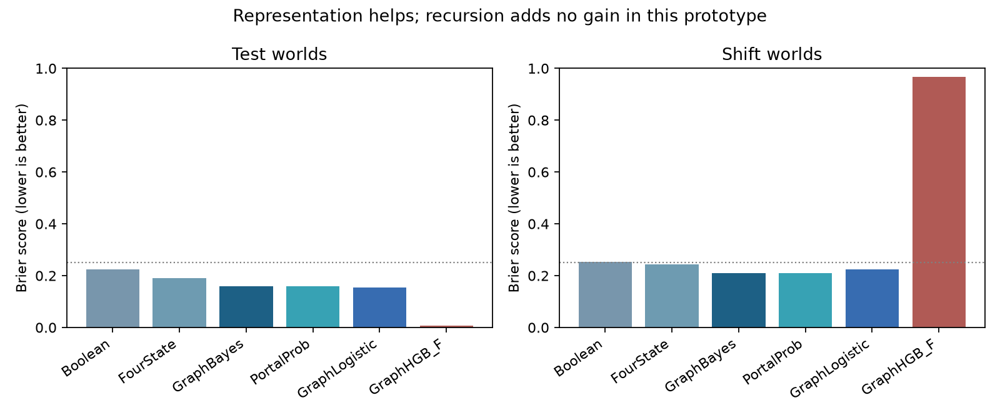

# SRDE / Blackbird: What do 1 and 0 mean?

Executed research continuation • 3 November 2026 • SRDE-BINARY-20261103-v1

Concept and hypothesis: Dan Merluse. Protocol, computational prototypes and analysis: AI-assisted. Status: completed bounded CPU experiments; no native SRDE deployment or human cognitive validation.

## Finding and decision

The evidence supports a specific version of the hypothesis: collapsing evidence, activation, context and affect into a single Boolean loses useful distinctions. It does not support a defect in binary mathematics or a unique recursive-portal advantage. Binary storage can encode every richer representation used here with additional bits and a defined schema.

Across 6,000 unseen synthetic cases, calibrated Boolean positive-present scored AUC 0.6300 / Brier 0.2234, four-state evidence 0.7658 / 0.1902, and evidence-weighted graph/portal reasoning 0.8500 / 0.1585. A conventional logistic graph learner was better on ordinary unseen worlds (0.8562 / 0.1549). On 6,000 shifted cases the graph and portal methods tied at 0.7322 / 0.2096. The recursive and iterative implementations produced exactly equal probabilities in this prototype. That equality is an implementation-equivalence result, not a finding about all possible SRDE architectures.

The independent handwritten-digit task reached a clean-data ceiling for every method. Under the fixed image shift, conventional logistic and RBF grounders outperformed the graph/portal variant. This is observed-image classification, not evidence of a system learning general human meaning or forecasting events.

## 1. Recovering the research lineage

[S1] The November 2 public Portal Hypothesis v0.1 defines conditional transitions, signed votes, activation decay, provenance, contextual state and F as felt valence. It already separates activation from occurrence and warns that path existence does not imply truth. Its 100-level examples concern noisy binary channels and random connectivity, not semantic discovery. Source: https://github.com/MerluseDan/FACO9000/blob/main/research/srde/portal-hypothesis-2026-11-02/README.md . Retrieved text is preserved in sources/portal_hypothesis_v01.md. The current source was retrieved, not silently treated as an immutable original commit.

[S2] The November 3 unseen-data evidence archive was downloaded from the authenticated Drive connector and preserved intact as sources/prior_evidence.zip. Source: https://drive.google.com/file/d/1IO9B6b1NjNyhh9_SDstFbHMwD3yJsb8S/view . The earlier report and reproduction script are also extracted separately. That report found Portal AUC 0.6083 versus Katz 0.6638 on FB15k-237 V1, and a conventional full-feature model slightly ahead on its authored simulator. Those are separate studies; their denominators are not pooled with this round.

I executed its Node reproduction script locally against the four public GraIL files, validating every expected Git blob identity. The original test scores reproduced: Portal AUC 0.6082926829, MRR 0.3141947078; Katz AUC 0.6637804878, MRR 0.3556126984; graph consensus AUC 0.6080487805. The dataset has 4,245 training facts and 205 test facts with zero train/inference entity overlap. All four input files are now bundled, so a rerun needs no internet. This closes the earlier report's outstanding full local real-data rerun, for that exact pilot protocol only. It retains the original 20 sampled negatives and is not an official all-entity GraIL evaluation or a new hard-negative benchmark. The rerun reports 597 aggregate traversal cutoffs across training/evaluation work; the aggregate alone does not identify which query phase hit its cap. Do not repeat an unqualified claim that the entire run had no cap hits.

[S3] E30 was read from the archived results report and its local continuation summary. Main graph_state 43/80 versus srde_activated 38/80; same-generator confirmation tied at 18/40 each. The continuation notes that activation changed 24 main prompts and hurt five / helped zero; that is an ordering/selection research lead, not a demonstrated cause. E30 is real Qwen inference over synthetic memory QA, distinct from today's numeric methods. The Colab campaign remained unrun in that source. Source: https://drive.google.com/file/d/1rWVGiB4-ngjEnNDwP-apC6U3U_kfb1Kt/view . No E30 model calls were repeated here.

E28 remains a provenance gap. Drive keyword searches, the existing Blackbird reference area and targeted local SRDE/continuation searches did not recover an identifiable E28 primary results package. A historical omissions record points to Library ID libfile_2bd5569ea874819188f07a6838f181e0; that pointer is not a retrieved result. No E28 score is asserted or used in this analysis. Generic continuation search hits were not treated as the requested November 2–3 SRDE reports without matching content. The two relevant November 2–3 conversations were directly read; their source IDs are in SOURCES.json.

## 2. A representation contract for 1 and 0

### Symbols and assertions

A bit is an element of a two-symbol alphabet. It acquires meaning through a codebook and a typed proposition. The bit 1 could mean a switch is energized, a glyph was classified as one, or evidence supports a proposition. None is automatically interchangeable. Relabeling both classes and predictions leaves accuracy and Brier unchanged. Our exhaustive two-codebook probe gives expected accuracy 0.5 without an anchor and 1.0 with the correct anchor; it demonstrates finite symmetry, not learning.

### Truth and evidence state

The simulator's gold y is an actual binary target. The observer's evidence state is a different object, encoded by two independent support-presence bits (positive, negative):

| Evidence pair | Name | Meaning |
|---|---|---|
| (0,0) | neither | No eligible evidence either way; current truth unknown |
| (1,0) | true-only support | Evidence for, none against; not guaranteed truth |
| (0,1) | false-only support | Evidence against, none for; not guaranteed falsehood |
| (1,1) | both | Contradictory evidence retained |

Absence is a property of the record/source; unknown is the observer's state. An explicit unknown report and no report can lead to the same two-bit evidence state while retaining different provenance metadata. Stale is a temporal qualifier, not automatically a fifth truth value. Balanced conflict and total ignorance may both yield probability 0.5, so probability alone cannot preserve the distinction.

The finite probe executes all 16 pairs of evidence states for conjunction/disjunction, using Belnap–Dunn-style support pairs: negation swaps coordinates; conjunction is (positive AND, negative OR); disjunction is (positive OR, negative AND). An exhaustive De Morgan check passes. A contradiction does not license arbitrary unrelated truth support. This is a small connective implementation, not a complete theorem prover. Four-valued evidence logic and probabilistic uncertainty answer different questions and can be used together. Research context: https://arxiv.org/abs/2111.09978 [S4].

### Activation, evidence, votes and affect

Activation controls whether a report participates. Deactivation contributes no eligible vote; it does not assert the negation. A signed vote is likelihood evidence for or against the typed query after composing the signs along its path. Copies share a lineage and count once. Context selects the proposition's interpretation; age changes its current relevance.

F stays in [0,1], with 0 aversive and 1 pleasant, as requested and as defined in S1. F is a separate valence variable, not truth, confidence, reliability or arousal. The simulator deliberately correlates F with y in development and reverses that correlation in shift. This is an artificial shortcut stress test and contains no human affect measurements. It cannot establish any psychological association between pleasantness and accuracy.

A candidate future record schema is: typed symbol/codebook; proposition; context; evidence-for and evidence-against records; lineage; observation and validity time; activation; posterior probability; separate F and arousal fields. Keep the support state even when a posterior is available. This is a research recommendation, not an installed schema migration.

## 3. Frozen execution design and leakage controls

PROTOCOL.json was written before scoring. FREEZE.json records its hash, the experiment-code hash, a UTC timestamp and every digit split before fitting. The frozen code was not changed after this receipt. This is a local pre-run freeze, not an independently witnessed public preregistration. Any separately running SRDE research in another chat is independent and was not interrupted or modified.

Five fixed seed families each contain 40 training, 10 calibration, 20 test and 20 shifted worlds, with 60 cases per world: 12,000 training, 3,000 calibration, 6,000 ordinary test and 6,000 shifted cases overall. All 27,000 source cases are preserved in compressed JSONL. World IDs are disjoint within each family and include their generating seed. The data are newly authored worlds from one designed mechanism, not independent empirical worlds.

Each case has four possible independent lineages; some are absent, inactive, old or in the wrong context. A lineage emits a noisy signed assertion through a 1–3 edge invertible sign path. Up to four exact copies share its history and noise. Maximum processed evidence is 48 edge occurrences/case (observed maximum 48). All methods use the same record packets. Hard negatives are the predeclared slice y=0 with at least one positive decoded report: 2,039 ordinary / 2,476 shifted cases. This slice is selected for evaluation only; it is not used to fit or calibrate models and is not a HeaRT link-negative sampler.

Generator source reliability is explicitly observable and ranges from 0.65 to 0.9. Historical perturbations are independent per lineage with relevance decay exp(-age/3). Wrong-context assertions concern an independent proposition. Shift increases old reports and copies and reverses the artificial affect correlation. These known mechanisms favor methods that preserve those distinctions. They do not demonstrate discovering unknown mechanisms from experience.

The primary pair implements the same conventional log-likelihood sum: effective reliability r_eff = 0.5 + (r-0.5) exp(-age/3); posterior = sigmoid(sum signed_vote × log(r_eff/(1-r_eff))). Eligible reports require activation and matching context, with one contribution per lineage. GraphBayes composes edge signs iteratively; PortalProb does it recursively. Their targets, priors (0.5), eligibility, memory and evidence caps match. The decay constant is authored and known, not estimated from test labels. Sign paths are invertible by construction; real causal reversal is not assumed.

Conventional logistic regression and histogram gradient boosting receive aggregate graph features, including the likelihood scores and the same evidence-state/context/time/provenance information. Their fixed settings and one-fit-per-seed budget are in the protocol. GraphHGB_F additionally receives F to expose shortcut learning. Ablations intentionally remove information and therefore test representation loss, not equal-information architectural superiority. Algorithms have different parameter counts and CPU work; no equal wall-clock or dollar comparison is claimed. No hyperparameter tuning was done on any split.

Every score receives a sigmoid calibration fitted only on separate calibration worlds. Raw scores are retained in the prediction CSV alongside calibrated scores. GraphBayes's raw Brier is slightly better than its calibrated Brier: 0.1579 versus 0.1585 on test; 0.2079 versus 0.2096 on shift. Calibration did not improve this already well-specified score. Confidence calibration is an empirical property, not something a sigmoid guarantees; see S5, https://arxiv.org/abs/1706.04599 .

## 4. Synthetic outcomes

The following are arithmetic means across five equal-size seed results. AUC is computed within each seed, then averaged; it is not a pooled AUC. Lower Brier is better. The uninformed balanced prior has expected Brier 0.25.

| Method | Test AUC | Shift AUC | Test Brier | Shift Brier |
|---|---:|---:|---:|---:|
| Boolean | 0.6300 | 0.5561 | 0.2234 | 0.2538 |
| ActivationOnly | 0.4985 | 0.4995 | 0.2517 | 0.2525 |
| SignedVotes | 0.7885 | 0.6471 | 0.1877 | 0.2673 |
| FourState | 0.7658 | 0.6416 | 0.1902 | 0.2440 |
| GraphBayes | 0.8500 | 0.7322 | 0.1585 | 0.2096 |
| PortalProb | 0.8500 | 0.7322 | 0.1585 | 0.2096 |
| GraphLogistic | 0.8562 | 0.7081 | 0.1549 | 0.2244 |
| GraphHGB | 0.8416 | 0.6955 | 0.1626 | 0.2257 |
| NoLineage | 0.8309 | 0.7185 | 0.1697 | 0.2179 |
| NoContext | 0.8217 | 0.7090 | 0.1728 | 0.2182 |
| NoTime | 0.8310 | 0.6816 | 0.1683 | 0.2397 |
| NoPathSign | 0.4968 | 0.4931 | 0.2523 | 0.2526 |
| AffectOnly | 0.9995 | 0.0006 | 0.0082 | 0.9777 |
| GraphHGB_F | 0.9995 | 0.0027 | 0.0067 | 0.9665 |

GraphBayes and PortalProb have maximum raw probability difference zero, also yielding identical calibrated predictions. The predeclared paired whole-world Brier difference PortalProb minus GraphBayes is exactly 0, bootstrap interval [0,0], on each split. This is not statistical evidence that all portal mechanisms equal all graph algorithms: the tested pair is mathematically equivalent by construction.

The conventional graph logistic model improves ordinary-test Brier by 0.00355 versus GraphBayes (95% world-bootstrap interval -0.00535 to -0.00191). It loses 0.01485 on shift (0.01153 to 0.01808). More flexible learning is not automatically more robust than a correctly specified generative score. GraphHGB is also worse than GraphBayes on both splits. No method is proclaimed universally strongest.

Boolean minus GraphBayes Brier is +0.06491 [0.05926,0.07083] on ordinary worlds and +0.04423 [0.03938,0.04915] on shift. FourState minus GraphBayes is +0.03175 [0.02815,0.03519] and +0.03448 [0.02997,0.03894]. Four evidence categories help preserve distinctions, but discard weights and age information; their presence alone does not make the posterior accurate.

Dropping lineage, context or time worsens Brier. Shift penalties are +0.00831, +0.00865 and +0.03017 respectively, with all corresponding recorded intervals above zero. Ignoring the sign transformations gives chance performance. Activation alone is also at chance. These effects are conditional on the authored mechanism; the score was not asked to discover it.

Shuffled-label AUC across the five ordinary test sets ranges from 0.4897 to 0.5232, averaging 0.5086. This is a label-permutation sanity check on fixed predictions, not an exhaustive audit of possible leakage. IDs and gold labels are not supplied to feature extraction or prediction functions; source generation and grading still share one project/author.

## 5. Abstention, misleading confidence and false assertions

Acceptance means max(p,1-p) >= 0.8. The threshold was fixed before scoring; it was not selected to achieve an observed risk target. Coverage is the accepted fraction, and risk is error within accepted predictions. ECE is a descriptive equal-width 10-bin statistic, sensitive to binning and sample size. Hard-negative FPR uses the ordinary 0.5 classification threshold, not the abstention threshold. Rates below are seed means; raw counts are in the result files.

| Method / split | Coverage at 0.8 | Error among accepted | ECE (10 bins) | Hard-negative FPR |
|---|---:|---:|---:|---:|
| Boolean / test | 0.1903 | 0.1587 | 0.0291 | 1.0000 |
| FourState / test | 0.5150 | 0.1789 | 0.0285 | 0.6132 |
| GraphBayes / test | 0.4705 | 0.1019 | 0.0353 | 0.3521 |
| GraphLogistic / test | 0.4843 | 0.1001 | 0.0350 | 0.3302 |
| GraphBayes / shift | 0.1797 | 0.1252 | 0.0442 | 0.4614 |
| FourState / shift | 0.4612 | 0.3162 | 0.0906 | 0.6665 |
| GraphLogistic / shift | 0.2780 | 0.2211 | 0.0799 | 0.4231 |
| GraphHGB_F / shift | 0.9838 | 0.9869 | 0.9704 | 0.9843 |

On shifted worlds, GraphBayes accepts only about 18% of cases and errs on about 12.5% of accepted cases. That is useful caution within the simulator, but it is not guaranteed 80% accuracy under arbitrary shift. The four-state scorer accepts more and errs more. Boolean predicts positive on every hard-negative case by construction; this deliberately weak flag is a representation-loss control, not the strongest conventional baseline.

The F-aware HGB score goes from 99.15% ordinary accuracy to 1.87% shifted accuracy. Its shift Brier is 0.9665 and it accepts 98.38% of cases, making it confidently wrong. F-only also reverses from near-perfect to almost wholly wrong. A highly predictive development correlation cannot define truth. This pathology is deliberately severe and should not be presented as an empirical result about emotion.

## 6. Independent source: grounding observed 0 and 1 glyphs

The bundled scikit-learn UCI handwritten digits source supplies 360 images labeled 0 or 1, with 64 grayscale pixel features per image. Source documentation: https://scikit-learn.org/stable/modules/generated/sklearn.datasets.load_digits.html [S6]. These observations were not written by the experiment designer. The task selection, binary subset and corruption were authored here. Original row IDs, all pixels and gold labels are included in digits_source.npz.

Five stratified 60/20/20 row splits give 216 training, 72 calibration and 72 held-out images each. Each split excludes its own held-out image rows from fitting and calibration. The same 360-image source is reused across seeds, so 360 held-out row occurrences are not 360 independent new images and seed results are descriptive. Writer IDs are unavailable here; this is not a verified unseen-writer split. Rotation of 20 degrees and Gaussian noise sigma 0.12 define shifted test inputs. Calibration remains fitted on clean calibration rows only.

PixelLogistic and PixelRBF learn the symbol-to-pixel association. BitRBF thresholds each pixel at 0.5, losing grayscale information. GraphKNN uses k=10 weighted train neighbors; PortalDiffusion3 applies two additional train-graph diffusion steps with label restart. It is an inductive graph-diffusion analogue, not the original installed SRDE or a complete nested-space portal system. Query images attach only to the training graph: no test-test edges or test labels. The same k=10 graph is available to each, but diffusion has more propagation work. RBF and logistic are strong conventional controls for this small task, not an exhaustive modern representation-learning benchmark.

| Grounder | Clean accuracy | Shift accuracy | Shift Brier |
|---|---:|---:|---:|
| PixelLogistic | 1.0000 | 0.9972 | 0.0048 |
| PixelRBF | 1.0000 | 0.9944 | 0.0036 |
| BitRBF | 1.0000 | 0.9639 | 0.0260 |
| GraphKNN | 1.0000 | 0.9889 | 0.0079 |
| PortalDiffusion3 | 1.0000 | 0.9889 | 0.0079 |

All clean methods reach 100% mean accuracy, leaving no clean-test room for a portal improvement. Under shift, PixelLogistic is 99.72%, PixelRBF 99.44%, BitRBF 96.39%, and both graph variants 98.89%. The thresholded bits remain a valid representation, but this lossy threshold is less robust in this corruption condition. There is no evidence that floating-point numbers are intrinsically semantic or that binary machines cannot ground concepts.

A contextual assertion reversal changes what counts as true: in context 1, the target becomes 1 minus the original class. Leaving the interpretation unchanged gives 0% clean accuracy for every method; applying the explicit context codebook restores 100%. Complementing both the target and p leaves Brier invariant. The mapping is supplied, not autonomously discovered. This isolates codebook dependence and does not establish open-ended concept learning, consciousness, motivation or affect.

## 7. Reproducibility, costs and verification

The new full experiment completed in 15.53 seconds in its measured Python region on CPU with numeric-library threads set to one. This excludes package installation, source recovery, report construction, operator/tool delays and the earlier graph rerun. Python 3.14.4, NumPy 2.5.4, SciPy 1.18.1, scikit-learn 1.9.1; the full environment is locked in requirements-lock.txt. No GPU, Colab runtime or paid compute was launched. GPU acceleration is unnecessary for these small computations. Host energy and peak RAM were not metered; elapsed time is not a cost-saving claim.

A second complete fresh-process execution produced byte-identical synthetic and digit prediction CSVs, metric JSON, split JSON, integrity results and bootstrap output. Decompressed raw synthetic source data also match exactly. Gzip and NPZ container timestamps can differ, so raw-container byte identity is not the replay criterion. Timings are intentionally not expected to match. REPRODUCTION_CHECK.json records eight successful comparisons.

Eighteen focused tests pass, covering evidence states, inactive/negative distinction, unknown/false distinction, source-copy invariance, independent corroboration, temporal decay, context, affect separation, signed path composition, contradiction, De Morgan behavior, non-explosion countermodel, symbol permutation, generator replay, recursive/iterative equivalence, split disjointness, query independence and bounded probabilities. Finite probes separately execute 16 connective pairs and four codebook/decoder combinations. These tests support implementation behavior within the prototype; they do not certify external semantics.

The package contains complete source cases, individual predictions (raw and calibrated for synthetic), splits, frozen protocol/code receipt, all metrics, timings, tests, source references, previous study package, four public graph input files, generated report, chart and a SHA-256 payload manifest. The separate archive checksum identifies the delivered ZIP. Drive delivery is to Blackbird Knowledge Repository / UpdateInbox / SRDE_Binary_Semantics_2026-11-03; authenticated metadata and byte readback receipts are delivered separately to avoid self-referential archive hashes.

## 8. Research questions, inference points and next acceptance gates

RQ01 — Can source reliability, context eligibility and temporal persistence be learned without the known generating values? Today's results show a representation benefit under known mechanics, not discovery. Next: a timestamped empirical source with a frozen future horizon and unknown reliability, compare learned graphical and portal scores. Sources: S1, results/synthetic_metrics.json, paired_bootstrap.json. Status: open.

RQ02 — What does a portal add beyond ordinary path composition and graph inference? Primary pair equality plus the independent graph-diffusion tie provides no unique benefit. Specify a non-equivalent learned routing/allocation rule and compare against an equal-information graph learner with measured preprocessing and propagation budget. Source: integrity.json and digit metrics. Status: superiority unsupported for this implementation; broader architecture unresolved.

RQ03 — Can unknown and contradiction improve decision handling beyond a posterior alone? The finite collapse probe proves representational ambiguity. The probabilistic experiment does not test escalation cost or human usefulness. Next: independently labeled conflicting-source queries with explicit abstention/escalation utility. Sources: semantic_probes.json, S4. Status: distinction demonstrated; downstream benefit open.

RQ04 — Can ordering-only E30 changes explain the earlier activation loss? Freeze the same evidence records and alter only ordering, then separately selection. Do not rerun the old frozen E30 with new settings and call it the same experiment. Source: sources/E30_CONTINUATION_SUMMARY.md. Status: not executed here.

RQ05 — How robust are provenance labels to hidden common ancestors or conflicting copies? Today's lineage IDs are perfectly observed and copies are identical. Next: partial/incorrect lineage graphs and source spoofing with independent adjudication. Source: NoLineage ablation and duplicate-invariance test. Status: open.

RQ06 — Can confidence and abstention retain useful coverage under genuinely new mechanisms? Present acceptance thresholds are unguaranteed under shift; calibration slightly worsened the well-specified score. Next: freeze utility/cost targets and evaluate prospective calibration drift, base-rate shift and selective risk curves. Sources: S5 and raw/calibrated predictions. Status: conditional finding, no general guarantee.

RQ07 — Does learned grounding scale beyond an easy binary glyph task and supplied context reversal? Next: held-out writers, unfamiliar symbol alphabets, sparse anchors and a wider concept set, with linear/RBF/neural and graph baselines under the same label budget. Source: digits_source.npz and digits_splits.json. Status: binary supervised grounding executed; general semantics untested.

RQ08 — Does F have a predictive role when it is measured separately from belief and context? Today's F is invented and reverses by design. Next: only an appropriately consented, independently sourced dataset with separate affect and factual labels could address this question; no human-data collection is initiated. Source: GraphHGB_F and S1. Status: no cognitive or affective claim supported.

RQ09 — Do deeper learned paths survive hard link negatives across multiple graph families? The exact old FB15k pilot rerun is confirmed but not upgraded to HeaRT or modern GraIL/NBFNet/SEAL comparisons. Source: S2, https://arxiv.org/abs/2306.10453 [S7]. Status: still pending; do not present current baselines as those models.

RQ10 — Can the E28 original and later continuation reports be recovered and reconciled with these findings? Preserve source roles and corrections; no score from an inaccessible source. Source: SOURCES.json and local historical omissions pointer. Status: unresolved source gap.

## 9. Boundaries of the conclusion

This work is an executed research prototype with strong conventional controls appropriate to its small tasks. It is not native Blackbird integration, a full test of nested semantic coordinates, an adaptive worker scheduler, a modern graph-neural benchmark, a chronological real-event forecast or a validated human cognitive theory. The two primary implementations intentionally share one mathematical rule, and the synthetic generator deliberately rewards richer evidence representation. Their equality and ablation results must be interpreted within that construction.

The practical research direction is to define the proposition and evidence semantics before selecting a numeric encoding, preserve unknown/conflict/provenance/time/context, and test learned mechanisms against conventional equivalents on genuinely independent empirical outcomes. The executed results do not justify promoting a unique SRDE superiority claim.
