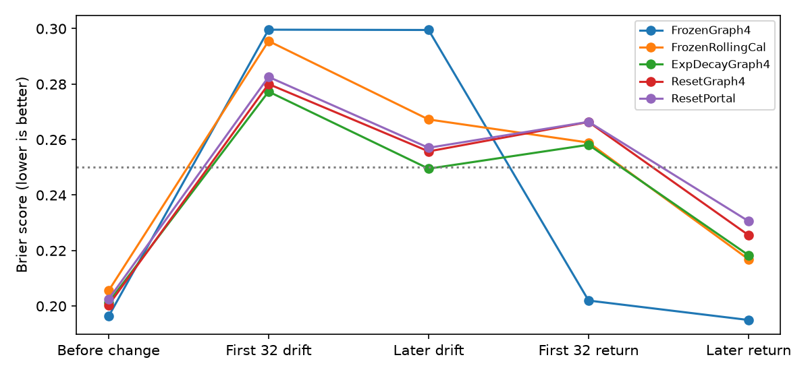

# SRDE: delayed feedback, drift detection and recovery

Executed bounded simulation • 3 November 2026 • SRDE-DELAYED-FEEDBACK-20261103-v1

Concept and research direction: Dan Merluse. Protocol, code, audits and analysis are AI-assisted. No native SRDE application was modified.

## Finding

Delayed feedback can improve predictions during a changed regime, but this experiment's adaptation policies do not deliver an overall win. The recursive reset policy has a worse full-deployment Brier score than frozen trust, and its conventional sequential counterpart produces exactly the same predictions. The reset detector catches all first simulated changes but triggers in many unchanged worlds. More frequent reconsideration is not automatically better evidence management.

The useful new inference is a tradeoff: recovery during drift must be assessed together with false alarms, temporary ignorance, delayed learning and relearning costs after conditions return. Selecting only the drift period would hide the losses elsewhere.

## Public freeze and source lineage

PROTOCOL.json was committed publicly before outcome computation in commit 58b0fed6b2fb3f57ffb1b01ecefeae733b898b56; FREEZE.json followed in da3d7a288515aca606bddfc47dcb21306c5f0316. The latter binds the runner, reused helper and protocol by SHA-256. No scientific code or settings changed after this freeze. Source: https://github.com/MerluseDan/FACO9000/tree/main/research/srde/delayed-feedback-2026-11-03 .

The preceding learned-temporal experiment found useful effective source/age weights under stable conditions and failure under unexpected source/dynamics change. This follow-up uses new seed families and a separately authored stream. Prior report: https://github.com/MerluseDan/FACO9000/blob/main/research/srde/learned-temporal-2026-11-03/RESEARCH_REPORT.md . Other active research, including P3's separate observational preregistration, was preserved and not interrupted. Results from different experiments are not pooled.

## Frozen design and chronology

Five seeds, 20 worlds per seed and two context states per world produce 76,000 source cases: 20,000 training, 6,000 calibration and 50,000 deployment cases. Seven methods generate 350,000 deployment predictions over the same 50,000 cases. The first 10 worlds of each seed contain changes; the other 10 remain unchanged, yielding 50 changed and 50 control worlds.

Training issue times are 20–119, calibration 130–159 and deployment 170–419. The event is the binary context state at t+1. Reports refer only to t-age with ages 0, 1, 3 or 8. The label becomes available at target_time+7, therefore eight steps after issue. The evaluator delivers matured labels before the next predictions. A learner receives no unrevealed label, latent state, change flag or true source reliability.

In changed worlds, the first four of eight sources invert at a random hidden time 230–250 while the state flip probability rises from .08 to .2. At a hidden time 330–350, both return to their previous process. Control worlds retain .08 and their original sources. Source rates vary across worlds; online improvement may therefore reflect local calibration as well as drift response. No claim isolates those effects without further ablations.

Reports may be missing, inactive, wrong-context or duplicated. All methods can inspect headers but decode at most four independent eligible votes per prediction. Online source updates use only the votes actually consumed by that method; uninspected source assertions are not retrospectively supplied for free. Training uses the same eligible observations for every method. Updates and calibration incur additional computation, so a common vote cap does not mean equal wall-clock cost.

## Policies

FrozenGraph4 keeps the training-derived source/age weights and calibration. FrozenRollingCal keeps those weights but refits a sigmoid on the last 128 resolved forecasts every 32 labels, starting after 64 labels. Window128Graph4 learns from the last 128 resolved cases; its initial pseudo-count mass fades over the first 128 feedback cases. ExpDecayGraph4 discounts non-prior counts by .98 per resolved case. Source/age evidence is estimated from observed correctness rather than supplied by the generator.

ResetGraph4 watches mean squared error over the last 32 revealed forecasts. The threshold is the method's calibration Brier plus .10, with at least 64 revealed labels between resets. On an alarm it resets source counts to Beta(2,2), ignores source updates from forecasts issued before the reset and returns probability .5 until 32 post-reset cases have resolved. This represents temporary ignorance, not a claim that the event became false.

ResetPortal uses the same detector and feedback rules but reads at least two ranked votes, stopping when absolute cumulative log odds reaches logit(.85), with a four-vote cap. ResetSequential implements exactly that policy without recursion. Their learning trajectories, alarms and forecasts are checked for equality. The fixed thresholds/window sizes were not tuned against deployment outcomes.

## Results

These are pooled scores over the corresponding cases in the five seed families. Brier is mean squared probability error: lower is better; a constant .5 forecast scores .25. Phases are classified retrospectively by the evaluator and are never supplied to predictors. “Late” starts 32 issue steps after the change or return.

| Method | All Brier | Changed worlds | Unchanged worlds | Late drift | Late return |
|---|---:|---:|---:|---:|---:|
| FrozenGraph4 | 0.2166 | 0.2388 | 0.1943 | 0.2995 | 0.1950 |
| FrozenRollingCal | 0.2239 | 0.2433 | 0.2046 | 0.2673 | 0.2168 |
| Window128Graph4 | 0.2233 | 0.2413 | 0.2054 | 0.2537 | 0.2210 |
| ExpDecayGraph4 | 0.2202 | 0.2350 | 0.2054 | 0.2495 | 0.2183 |
| ResetGraph4 | 0.2184 | 0.2392 | 0.1975 | 0.2558 | 0.2255 |
| ResetPortal | 0.2206 | 0.2415 | 0.1998 | 0.2570 | 0.2306 |
| ResetSequential | 0.2206 | 0.2415 | 0.1998 | 0.2570 | 0.2306 |

The portal's full-deployment Brier is 0.22063 versus 0.21655 for frozen trust: delta +0.004071, 95% whole-world bootstrap interval [+0.001693,+0.006376]. Its changed-world delta is +0.002635 [-0.000610,+0.006166], which does not demonstrate a changed-world improvement. ResetGraph4's all-world delta is +0.001834 [-0.000365,+0.004075]. Its interval includes zero.

Exponential forgetting improves the changed-world total by -0.003833 [-0.006286,-0.001226], but loses overall by +0.003658 [+0.001643,+0.005693]. That is a conditional benefit, not a universal adaptation advantage. Rolling recalibration and the short evidence window also lose on the full deployment. The periods after the original process returns expose relearning costs that a one-way shift test would miss.

Bootstrap draws resample entire worlds, retaining serially dependent observations: 100 clusters overall, 50 for changed or unchanged subsets, with 1,000 fixed-seed draws. These descriptive intervals do not account for generator choice or multiple exploratory contrasts.

## Alarms, confidence and limits

ResetGraph4 raises at least one false alarm in 23/50 unchanged worlds, with 38 false alarms total. ResetPortal and ResetSequential raise alarms in 26/50 unchanged worlds, with 50 alarms each. For all three, every first changed regime has an alarm before the process returns; the median first-alarm lag is 22 time steps from the change. Detection of all changes is therefore accompanied by a high false-alarm burden. These are finite authored-world rates, not deployment guarantees.

Confidence .8 coverage/risk, AUC, accuracy, ECE, individual probabilities, vote counts, alarm times, early-phase losses and feedback availability are preserved in metrics.json and predictions.csv.gz. Fixed-confidence acceptance cannot guarantee reliability under a new regime. Source-copy handling does not remove every common cause of dependent forecast errors because the underlying state dynamics are shared.

The apparent overall preference for frozen trust depends on this mixture of stable worlds, changed periods and return periods. It does not imply that systems should never adapt. It rejects an overall improvement claim for these exact policies and this frozen workload. The reset threshold is crude, and a false-alarm-calibrated detector is a clear next research candidate; it was not tuned here after seeing the result.

## Execution and verification

The measured first-run Python region took 26.90 seconds on CPU, excluding design, package installation for older P2 audits, publication and reporting. Python 3.14.4, NumPy 2.5.4, scikit-learn 1.9.1; numeric library threads were limited to one. No GPU, paid resource or model download was needed. This round was executed locally; its result is not relabeled as a new Colab run. The earlier complete Colab run remains preserved in the preceding study.

A second local process reproduced the metric, alarm, control, fit-parameter and bootstrap JSON bytes exactly. Decompressed raw cases, latent gold and prediction CSV also match. All twelve final tests pass. The first test harness incorrectly delivered t+8 feedback and then tried predicting at t+1; two chronology guards rejected that invalid sequence. The harness was corrected to advance its clock. No frozen runner or experimental output changed; TEST_HARNESS_NOTE.md retains the correction.

Controls show no future-feedback update, no prediction input containing the gold y, a four-vote cap and recursive/sequential equality on every seed. The independent output audit recomputes Brier from all individual predictions, checks counts/keys/labels/timestamps and verifies the frozen source identities. These are implementation checks, not independent empirical validation of the authored event process.

## Questions retained

RQ-D01: Can a detector whose false-alarm rate is calibrated on a separate development stream improve the complete deployment utility, including stable periods, delay and return costs? Compare conventional sequential change detection/Bayesian filtering with portal allocation under the same feedback and computation budget. Status: open.

RQ-D02: How do feedback delays of different lengths and incomplete labels change adaptation? This round fixes an eight-step issue-to-feedback delay and has complete eventual labels. No general conclusion covers selective or permanently missing feedback.

RQ-D03: Can adaptive evidence collection avoid a self-confirming source-selection loop? Here learning sees only consumed votes. Exploration and lineage uncertainty need separate frozen comparisons; they were not added after seeing losses.

RQ-D04: Will the findings hold on a separate empirical timestamped source? These remain authored Markov/sensor worlds, not observed human states or real-world forecasts. E28 recovery and broader native SRDE integration remain unresolved.

## Publication and delivery

All earlier recovered tests were published first in GitHub commit 2f991ccec399aefebe075705bfd0c6c3d3ae190a. The corresponding private Drive snapshot contains 147 files and was downloaded again with byte identity and CRC verified. The present experiment has its own public directory and private UpdateInbox folder: https://drive.google.com/drive/folders/15315BGmLeDl4vq1XdsKbk5tudAGKip8r . Its runnable package includes the frozen sources, complete cases/predictions, latent gold for grading, metrics, alarm records, replay, audits, tests, this report and checksums. No old negative result was replaced.
