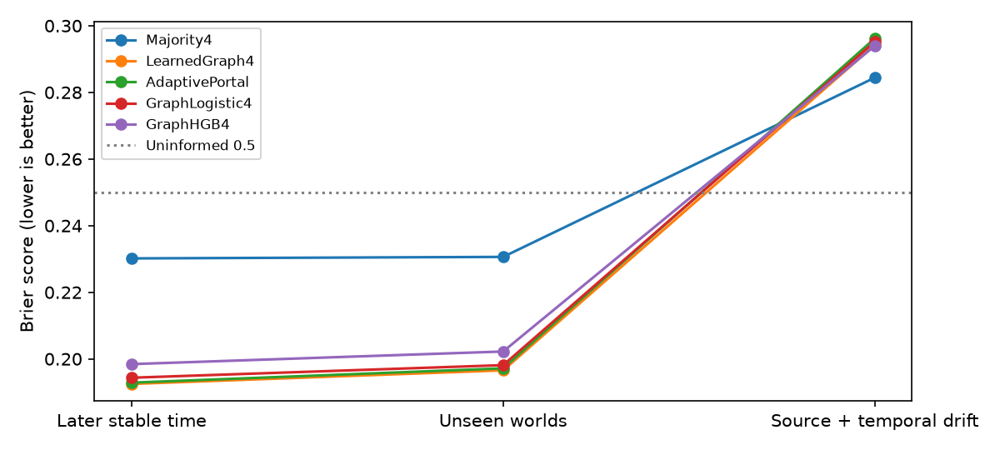

# SRDE: learned evidence reliability over time

Executed follow-up • 3 November 2026 • SRDE-LEARNED-TEMPORAL-20261103-v1

Concept and research direction: Dan Merluse. Computational protocol and analysis: AI-assisted. Frozen five-seed study executed locally and in Google Colab, using CPU on both. No GPU, paid runtime upgrade, Drive mount or new authorization grant was requested.

## Decision

Learning effective source-by-age evidence weights improves synthetic next-step predictions while the observation process remains stable. It does not solve unexpected source/dynamics drift. Adaptive portal stopping uses fewer votes but matches an ordinary sequential graph implementation exactly. No unique portal prediction advantage is supported.

The conventional learned graph score is slightly better than the portal on stable unseen worlds. The graph logistic and histogram gradient-boosting learners do not surpass that score under this fixed training/model-selection budget. After the deliberately strong drift, every learned evidence method is approximately chance and miscalibrated; even the uninformative probability 0.5 has better Brier than those frozen learned forecasts.

The previous round supplied true reliability and a decay function. This round supplies neither to predictors: it estimates predictive skill separately for each source and report age using training outcomes only. This learns effective forecast reliability, which combines sensor correctness and temporal persistence. It does not independently identify the hidden intrinsic sensor reliability or the true transition process. Those latent parameters remain in a separate generation/gold artifact, never passed to the fitting or prediction functions.

## Relationship to the earlier research

This is the next bounded simulation requested after the binary-semantics study, not an alteration of that study's frozen protocol. Prior report: https://drive.google.com/file/d/1usTQxSKLMjv5auAfWncKYXmcK16iZ7tS/view . Its RQ01 concerned learned reliability/persistence and RQ02 concerned non-unique graph/portal effects. The November 2 proposal motivates temporal preconditions and evidence-based votes: https://github.com/MerluseDan/FACO9000/blob/main/research/srde/portal-hypothesis-2026-11-02/README.md . The new study preserves its distinction between activation, evidence and occurrence.

E28 recovery and empirical chronological validation remain open. No old result is pooled with this run. The present observation process and its drift are authored simulations, so success does not establish real-event forecasting, human cognition or native Blackbird integration.

## Frozen data design

The protocol and complete simulation code were hashed before any new outcome computation, in FREEZE.json. Five seed families each contain 20 development worlds and 10 completely unseen worlds. Every world has two binary context states over 282 time points. The target is the state at t+1. Source reports refer only to t-age, with age in 0, 1, 3 or 8; no future observation is available to a predictor.

For the development worlds: training t=20..119; calibration t=130..159; later stable test t=170..219; drift test t=230..279. Gaps prevent the maximum-age report window in one split from overlapping the preceding split's target window. Completely unseen worlds supply t=170..269 with no training/calibration rows from those worlds. Later-time evaluation deliberately retains known-world identities; unseen-world evaluation is the separate entity/world generalization test.

Overall: 20,000 training cases, 6,000 calibration cases, 10,000 later stable cases, 10,000 unseen-world cases and 10,000 drift cases: 56,000 source cases and 30,000 held-out cases. Both platforms consume the exact same generated source cases and latent gold data. Cross-platform reruns are repeated computations of the same cases and are not independent new scientific samples.

Eight sources have hidden baseline accuracies. Six are drawn from 0.55–0.9 and two from 0.2–0.4, so learning can discover that some sources should be inverted. Reports may be absent, inactive, in the wrong context or duplicated. Each original source has one lineage per query, and duplicates are counted once. Path signs compose along one to three invertible edges; this is an explicit symbolic transform, not a discovered causal reversal.

Before drift the Markov state flip probability is 0.08 per time step. At time 230 in the development worlds it becomes 0.2 and the first four sources reverse their accuracy. Unseen worlds keep the stable mechanism. The drift is severe and deliberately diagnostic. Models receive neither drift labels nor a refit after it. Future states share a common transition process, so source-lineage independence alone does not guarantee conditional independence of forecast errors.

## Learning and matched evidence budgets

Using training rows only, a Beta(2,2) smoothed table estimates each source/age pair's probability of agreeing with the future target. Its learned signed log likelihood is log(r/(1-r)). That table can assign negative weights to systematically misleading sources and small weights to old reports. Training uses all eligible original lineages; every inference method has the same maximum of four decoded independent votes. All may inspect all headers to identify source, age, context, activation and copy lineage. Header scanning and sorting are not free and are not counted as vote savings.

LearnedGraph4 ranks eligible headers by absolute learned weight and combines up to four decoded reports. Majority4 uses those same selected reports but ignores learned vote polarity/strength; it is a weak control rather than the strongest conventional method. GraphLogistic4 and GraphHGB4 receive the same selected four votes as source-by-age features plus presence flags and the graph score. Settings are fixed: logistic C=1, max_iter=1000; HGB 100 iterations, 15 leaves, L2=1; one fit per seed, no hyperparameter search.

AdaptivePortal starts with two reports and opens additional ranked evidence until absolute cumulative log odds reach logit(0.85), or four reports have been read. The threshold was fixed before results. GraphSequential implements exactly the same stopping policy iteratively. This control isolates recursion from the evidence-allocation policy. Neither is a complete implementation of nested semantic coordinates or an autonomous worker scheduler.

Every method receives a sigmoid calibrator fitted only on its calibration split. Raw and calibrated outputs are preserved. No evaluation outcome is used to rank evidence, estimate weights, fit a model or calibrate confidence. Gold labels are removed in a prediction test without changing prediction features. Shuffled-label, timestamp, split, source-copy and recursion/iteration controls are included.

## Local outcomes

Values below are means across five equal-size seed results. Brier is mean squared probability error, lower better; AUC is discrimination, higher better. Metrics clip probability inputs to [1e-7,1-1e-7]. The neutral 0.5 forecast has Brier exactly 0.25 for any binary outcomes.

| Method | Later Brier | Unseen Brier | Drift Brier | Later AUC | Unseen AUC | Drift AUC |
|---|---:|---:|---:|---:|---:|---:|
| Majority4 | 0.2302 | 0.2306 | 0.2844 | 0.6661 | 0.6664 | 0.4307 |
| LearnedGraph4 | 0.1925 | 0.1966 | 0.2942 | 0.7803 | 0.7714 | 0.4982 |
| AdaptivePortal | 0.1929 | 0.1972 | 0.2962 | 0.7783 | 0.7687 | 0.4975 |
| GraphSequential | 0.1929 | 0.1972 | 0.2962 | 0.7783 | 0.7687 | 0.4975 |
| GraphLogistic4 | 0.1944 | 0.1981 | 0.2952 | 0.7757 | 0.7676 | 0.4968 |
| GraphHGB4 | 0.1984 | 0.2022 | 0.2939 | 0.7654 | 0.7575 | 0.4947 |

AdaptivePortal minus LearnedGraph4 Brier is +0.000372 on later stable cases, 95% world bootstrap interval [-0.000103,+0.000874]. On unseen worlds it is +0.000592 [+0.000098,+0.001111]. On drift it is +0.001941 [+0.001214,+0.002639]. Positive differences favor the conventional learned graph. The first interval includes zero; the other two indicate a small portal loss within this simulator.

The primary pair AdaptivePortal versus GraphSequential has exactly identical probabilities and vote counts on both platforms. Its Brier difference and interval are [0,0]. This is equivalence of these implementations, not a statistical discovery that all possible recursive systems are equivalent.

Bootstrap sampling uses complete world clusters, retaining all serially dependent observations within a selected world: 100 clusters for each known-world evaluation and 50 for unseen worlds across the five families. One thousand fixed-seed resamples are recorded. Multiple exploratory method contrasts are not corrected for family-wise testing; they should not be promoted as broad confirmatory claims. The best conventional method is identified descriptively from this fixed candidate set, not chosen and then re-evaluated as an untouched winner.

## Evidence allocation, abstention and failure under drift

On later stable cases, AdaptivePortal decodes 3.4784 votes per case versus 3.7933 for the fixed graph: 8.30% fewer decoded votes. It still scans the headers and performs ranking. This is a measured work-unit reduction, not a GPU, monetary or wall-clock saving. The conventional sequential policy achieves exactly the same reduction.

At fixed confidence 0.8, the portal accepts 30.09% of later stable cases with a seed-mean accepted error rate of 16.14%. On unseen worlds it accepts 28.53% with 17.38% error. After drift, it accepts 19.66% but errors on 51.01% of those accepted cases. Confidence that was meaningful in development does not remain trustworthy when sources reverse.

Hard negatives are false future outcomes with at least one eligible positive report. Their counts are 4,402 later stable, 4,522 unseen, 4,710 drift. Portal false-positive rates on this slice are approximately 0.3044, 0.3170, 0.5053 at the 0.5 classification threshold. This is a predeclared diagnostic slice, not a link-prediction negative sampler or an abstention-conditioned rate.

All source-copy, timestamp, maximum-four-vote and unseen-world controls pass. Shuffled-label AUC is approximately chance (per-seed values in controls.json). These checks do not eliminate every possible shared-author or generator-selection bias.

## Google Colab execution and reproduction

The notebook was created in the authorized account, its CPU setting was inspected, and the frozen code/protocol/receipt were loaded through Drive into this notebook: https://colab.research.google.com/drive/1oKsGyW5g8tHRCiZe49hvB0ri5z-aESKL . A CPU runtime was sufficient; no GPU was allocated, paid upgrade selected, Drive mounted or credential read. This does not establish that a free GPU is currently available or that a paid account's GPU usage would cost zero. Access and cost still need checking for each future GPU workload.

The complete simulation ran in Colab. Its measured Python region took 62.14s, compared with 15.26s locally. Those are descriptive runs on different hardware/software environments, excluding setup, notebook orchestration, file transfer and report work. They are not a matched hardware or economic benchmark.

Local: Python 3.14.4, NumPy 2.5.4, SciPy 1.18.1, scikit-learn 1.9.1. Colab: Python 3.13.18, NumPy 2.4.6, SciPy 1.16.3, scikit-learn 1.6.1. Both specify one thread for OpenMP/OpenBLAS/MKL.

The exact frozen code, protocol, freeze receipt, decompressed source cases and latent gold match across platforms. Every prediction for Majority4, LearnedGraph4, AdaptivePortal, GraphSequential and GraphLogistic4 matches exactly, including raw/calibrated arms. HGB predictions differ across scikit-learn versions. Its largest per-seed Brier difference is about 0.002390; the maximum recorded difference over the selected metric set is 0.0135 (a rate metric), so the overall 1e-6 metric-tolerance check fails. This is retained as a version-sensitive reproduction result, not hidden as a pass.

Colab HGB mean Brier is 0.1984 / 0.2022 / 0.2941 for later/unseen/drift, versus local 0.1984 / 0.2022 / 0.2939. Both preserve the same practical conclusion. Exact same-environment cross-platform HGB reproducibility remains untested; no dependencies were changed after inspecting results to produce a favorable comparison.

The ordinary Colab file-download route failed twice, including one browser-control timeout. The completed runtime was preserved. An evidence-only cell exposed the archive through notebook output; the exact visible bytes were recovered and SHA-256/ZIP CRC verified. Colab autosave placed large output in an embedded package that the Drive connector could not fetch (404); that failed route is recorded in COLAB_COMPARISON.json. The complete recovered Colab_CPU_Executed_Results.zip is included in the deliverable. Its SHA-256 is b33d8e6ff30c21f8b3221be7a53b88b73f13541657513a3e7a0b9690d21eaf5c.

A separate second local process produced byte-identical predictions, learned parameters, metrics, controls and bootstrap JSON; decompressed source data also match. Twelve focused tests pass for reproducible generation, temporal separation, no future reports, unseen worlds, training-only weight estimation, copy invariance, recursive/sequential equality, four-vote budgets, gold-free prediction, unknown prior, activation and finite learned weights. Tests and replay do not validate natural semantics or biological theory.

## Research points and next experiment

RQ-L01: Can intrinsic source reliability and state persistence be separately identified? This run estimates their combined forecasting effect. Next: freeze a latent-state learner and compare against learned conventional state-space/HMM models using only training observations. Status: unresolved; today's learning benefit is conditional.

RQ-L02: Can an online drift detector abstain or update using only labels available after a fixed feedback delay? The fixed policies failed decisively. Next: preregister delayed feedback, drift alarms, recovery lag, false alarms, calibration and total update cost; compare graph/Bayesian filtering and portal allocation under identical history. Do not use future drift labels to trigger a retrospective rescue. Status: next candidate, not executed here.

RQ-L03: Is the adaptive policy useful when header access, sorting and actual decoded-report costs are counted? It saves about 8.3% of votes on stable known worlds with a small scoring tradeoff, and ordinary sequential inference does the same. Next: instrument variable-cost evidence retrieval and compare utility at a fixed cost budget. Status: no unique recursion advantage.

RQ-L04: Does a separate empirical timestamped dataset reproduce the result? Today's Markov worlds are intentionally constructed and strong source reversals are authored. An independent prospective or chronological dataset remains necessary. Status: open; no real-world claim.

RQ-L05: How sensitive is HGB to version/runtime differences? Preserve both outputs. Next exact-platform comparison must pin compatible Python and scientific libraries before either platform runs. Status: version-sensitive disagreement retained.

## Delivery and scope

Canonical destination: Blackbird Knowledge Repository / UpdateInbox / SRDE_Learned_Temporal_2026-11-03. Source code, protocol/freeze, raw source cases, latent gold (for grading only), individual predictions, learned weights, raw/calibrated metrics, bootstrap results, local replay, Colab archive, tests, report, charts and checksums are included. A separate delivery receipt records authenticated Drive readback and downloaded-byte hashes.

The original notebook remains a runnable Colab deliverable and is moved into the same canonical folder. This study is complete as a bounded simulation, with a negative drift result and no unique portal advantage. It does not complete E28 recovery, empirical forecasting acceptance, native SRDE integration or human cognitive validation.
