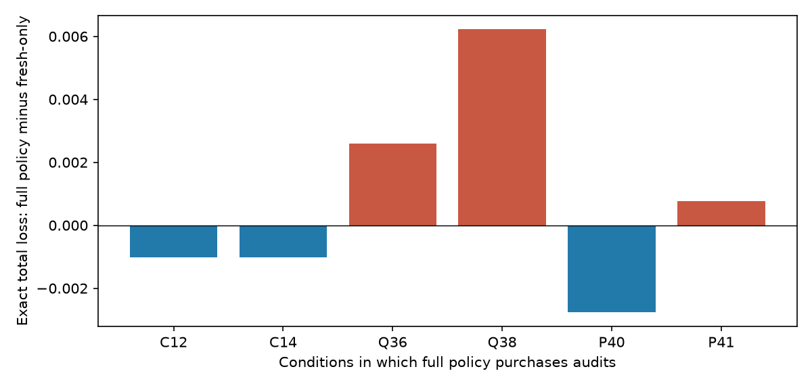

# SRDE LA1 — Is checking a source's lineage worth more than another report?

Executed 3 November 2026. Concept/research direction: Dan Merluse. Protocol, code, source review, analysis and audits are AI-assisted.

## Result

Lineage audits have a narrow value region in this finite known-model problem. The exact optimal policy purchases audits in only **2 of 36 correctly specified settings**: a low copy prior (.2), a perfect inexpensive audit (.00375 loss units), and a response that arrives within the three-slot deadline. Neither noisy audits of accuracy .8, expensive audits, uninformative audits nor late audits are worth purchasing anywhere else on this declared grid.

The primary exact expected total-loss difference, full policy minus fresh-only, is **-0.000057074** across the 36 settings. This is about 0.073% of the fresh-only loss: a small benefit conditional on the model and grid. In the two useful settings the difference is -0.001027334 per case, with audits requested on 19.2% of cases. That conditional effect is diluted across many settings where no audit is selected.

Overtrust reverses the gain. Holding the low copy prior and cheap audit fixed, an audit assumed perfect but actually uninformative produces +0.002597091 additional loss; an always-inverted audit produces +0.006221515. The exact recursive and conventional full-policy outputs and action traces are identical. There is no portal-specific superiority result.

## Why this does not repeat the other chats

Recent available turns of Recursive Portal Experiment, SRDE Research Options and Memory Worker Architecture were read before design. Their E01–E03 work concerns delayed learning, hidden source groups and change detection; E04 proposes selective suspension. P3–P4 test state/seasonal transition forecasts, and the newly published P5 preregistration tests affine path ordering and reverse instability. The memory-worker work tests governance and permission freshness under queue load. LA1 instead makes a fallible query about unknown source dependence compete with another assertion under an explicit decision budget. These conversations were read, not interrupted. Their reported results were not independently rerun here.

The full comparison, literature queries, scope and source links are in NOVELTY_AND_CROSS_CHAT.md. Dynamic copying inference, source selection, Bayesian information acquisition and uncertainty over provenance all predate this experiment. Recent GraphEcho already measures redundant paths, provenance and active exploration; PQ-EID already analyzes uncertain provenance partitions. LA1 is a documented extension of our SRDE evaluation program, not a new decision-theory algorithm or a certified worldwide first. [GraphEcho methods](https://arxiv.org/html/2609.17695v1); [PQ-EID](https://www.mdpi.com/1999-5903/18/11/582).

## Frozen design

The protocol, novelty record, runner and tests were published before scoring in GitHub commit **faad7f25854b278ce427995f85e9284ba3835c1b**, then their remote Git blob identities were checked against the local bytes. An earlier publication attempt returned a GitHub service error; absence of the freeze was confirmed before retrying. No experimental score was computed before the successful freeze.

There are 42 frozen conditions: 36 correctly specified settings, four audit-quality shifts and two copy-prior shifts. Exhaustive enumeration retains **6,528 positive-probability atoms and 58,752 policy forecasts**. A separately written sampler generates **21,000 held-out cases and 189,000 forecasts** across five untouched seeds. No hyperparameter or model selection uses these cases.

Y is the binary event. L indicates whether the first two of three initial reports are copies of one observation. Each original source has accuracy .8; the third is independent. Two optional new observations have accuracy .7. One audit observes L, with its own error rate and delay. Thus a binary audit response asserts something about provenance, not event truth. No affect/valence input is used in this round.

At most three actions occur before the terminal deadline: acquire an assertion, request the single audit, wait for it, or stop. Each assertion costs .015; audit cost is .00375 or .06. Delay is 0, 2 or 4 slots, with delay 4 arriving too late. A zero-delay response becomes usable at the next decision slot; there is no separate within-slot reaction. Costs are modeled decision-loss units, not money or compute bills.

The terminal action minimizes expected squared probability error or a fixed .15 abstention loss, then adds acquisition costs. Full Brier scores include probabilities even when a policy abstains. Coverage and error among accepted cases are reported separately. All methods receive known assumed generative probabilities; this is not a learned grounding or source-identification system.

## Correctly specified exact results

| Policy | Exact total loss | Full Brier | Coverage | Audit requests |
|---|---:|---:|---:|---:|
| StopBayes | 0.08294106 | 0.10454106 | 60.00% | 0.00% |
| NaiveIndependent | 0.08340355 | 0.11620355 | 60.00% | 0.00% |
| FreshOnlyDP | 0.07848208 | 0.09831585 | 73.47% | 0.00% |
| AuditFirst | 0.10998297 | 0.09830442 | 73.64% | 100.00% |
| GreedyVOI | 0.07913203 | 0.10175940 | 69.92% | 0.00% |
| SRDE_AuditRule | 0.07852022 | 0.09833533 | 73.55% | 5.33% |
| GraphFullDP | 0.07842501 | 0.09836151 | 73.52% | 1.07% |
| PortalFullDP | 0.07842501 | 0.09836151 | 73.52% | 1.07% |
| OracleLineageDP | 0.07704844 | 0.09698950 | 74.88% | 0.00% |

Lower loss/Brier is better. OracleLineageDP receives actual hidden L for free and is an information-advantaged diagnostic, not a fair competitor. GraphFullDP performs conventional reachable-state backward induction. PortalFullDP expands the same action graph recursively. Their equality is expected from their identical information and objective, and was checked both per model state and per emitted forecast.

Full-policy Brier is slightly worse than fresh-only here even though declared total decision loss is slightly better. The policy optimizes selective squared-error/abstention/cost utility, not full Brier. The two metrics must not be interchanged after the result. AuditFirst barely changes Brier in specified worlds but raises total loss substantially by buying audits regardless of value. The simple SRDE_AuditRule also loses narrowly to fresh-only on the full specified grid.

The independent sample estimates full minus fresh-only loss at -0.000073044, with a paired case-bootstrap interval [-0.000366424, +0.000166677]. It includes zero. The sample does not establish a statistically convincing improvement. The exhaustive calculation is exact for this finite distribution, not an estimate of real-world performance.

## Reliability and latency boundary

| Condition | Assumed/actual copy prior | Assumed/actual audit accuracy | Delay | Loss delta |
|---|---:|---:|---:|---:|
| C12 | 0.2/0.2 | 1.0/1.0 | 0 | -0.00102733 |
| C14 | 0.2/0.2 | 1.0/1.0 | 2 | -0.00102733 |
| Q36 | 0.2/0.2 | 1.0/0.5 | 0 | +0.00259709 |
| Q38 | 0.2/0.2 | 1.0/0.0 | 0 | +0.00622152 |
| P40 | 0.5/0.1 | 1.0/1.0 | 0 | -0.00276813 |
| P41 | 0.5/0.9 | 1.0/1.0 | 0 | +0.00075910 |

Only rows where the full policy actually requests audits are shown. C12 and C14 are the useful specified settings. Q36 and Q38 show audit-model failures. The high-copy-prior audit shifts Q37/Q39 do not cause full-policy damage because it never requests an audit there. P40/P41 show that a lineage-prior shift can change the value of an otherwise accurate audit in either direction. Averaging them hides that asymmetry.

Across all 42 settings, full-policy loss is 0.07863096, versus fresh-only 0.07851775: adding these six misspecification settings makes the pooled comparison worse. This arbitrary 36:4:2 mixture is a stress-test summary, not an estimated prevalence of failures. In the four audit-quality shifts alone, full loss is 0.08068674 versus 0.07848208. Always auditing and the simple pattern rule are more vulnerable.

## Verification and reproducibility

Fourteen pre-scoring analytic/contract tests passed and were rerun after scoring. A separate output auditor, which does not import the runner, recomputed every one of **247,752 forecasts**, its posterior, acquired evidence, response chronology, cost, abstention and total loss. Maximum aggregate discrepancy was 1.65e-14. A second independent optimizer partitions weighted latent-world atoms instead of using the runner's belief/transition code; it matches all 36 specified-condition optima within 1.39e-17.

An independent second Python process reproduced all eight scientific JSON and decompressed CSV outputs exactly. Gzip metadata and runtime are excluded from byte equality. The first measured run took 6.05 seconds on local CPU, excluding literature review, design, publication and reporting. No GPU, paid Colab allocation, new model or live app was used. Core reproduction and audits use only the Python standard library. Plot/PDF rendering is optional and uses matplotlib/reportlab.

## Limits and retained questions

The primary weak improvement from expanding an exactly optimized action set is guaranteed in principle under a correct known model. The measured contribution is the narrow region where that option is actually used and how model error changes its value; it is not a newly discovered theorem. Results depend on the selected accuracies, costs, priors, three-slot horizon and abstention loss. They do not show general portal superiority, human cognition, actual-world forecasts or an empirically calibrated source-verification service.

No independent empirical dataset was added. The sampler and exact enumeration are different implementations of the same authored mechanism. The states are not a longitudinal stream; there is no delayed gold learning, concept-drift detection, real scheduling or natural-language provenance extraction. Those broader parts of the earlier candidate remain open and are not claimed completed.

RQ-LA2: Can audit reliability itself be estimated and kept calibrated from independent, delayed verification without making verification circular? A distinct future protocol must first compare relevant reliability-learning and active verification research. RQ-LA3: What is the value of lineage queries with several possible copy partitions and shared-cause errors, where the current binary L simplification fails? RQ-LA4: Can an independently curated dataset support these distinctions with verified derivation chains and acquisition costs? These are candidates, not novelty-cleared next experiments.

Keep LA1 as completed bounded evidence. Do not promote the heuristic, arbitrary pooled mean or correct-model optimum into an installed SRDE capability.
